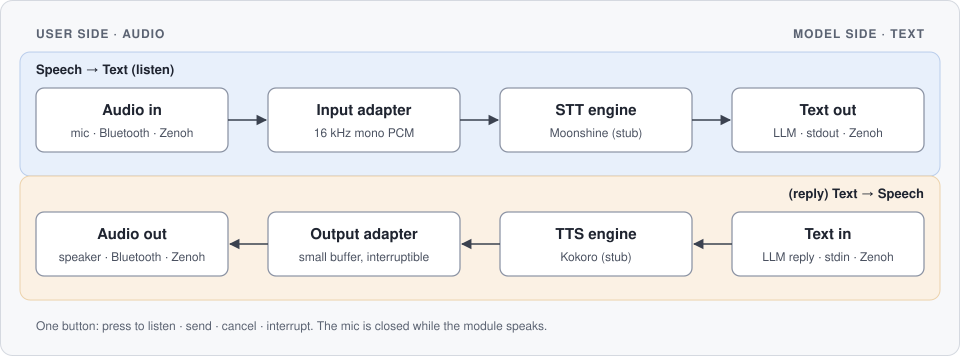

###
This project was designed with claude-opus-5-5 on 29102026. (10/29/2026)

# stt-tts

A local, bidirectional speech module for language models. Speech from any audio device becomes plain text for an LLM, and the LLM's text reply becomes speech again. It runs on the CPU, so the GPU stays free for the model.



> **Status: scaffold.** The workflow, state machine, installer, config and Zenoh wiring are real. The speech engines and audio devices are **stubs**. Search the code for `STUB:` to find every endpoint to replace. See [Stubbed endpoints](#stubbed-endpoints) and [What our rig uses](#what-our-rig-uses).

## How it works

- **User side is audio, in any modality.** A headset, a room speaker, a Bluetooth device, a network stream or a file each plug in as an adapter. Input is normalized to 16 kHz mono PCM.
- **Model side is text.** Transcripts go to any sink (an LLM adapter, stdout, a file, Zenoh). Text to speak comes from any source.
- **One button, no wake word.** A single context-sensitive control drives the module:

| State | A press does |
| --- | --- |
| Idle | Start listening |
| Listening | Stop and send what you said |
| Thinking | Cancel the reply and listen again |
| Speaking | Interrupt playback and listen again |

- **Half-duplex.** The mic is closed while the module speaks, so it never hears itself.
- **Interrupts are honest.** An interrupt emits the text actually spoken, so the LLM's context matches what you heard.
- **Two input modes, one result.** Burst (record a clip, send it whole) and stream (live transcription) both end as an utterance in, text out.

## Requirements

| | Minimum |
| --- | --- |
| OS | Linux, x86-64 |
| CPU | 4 cores with AVX2 (most Intel Core 4th gen and newer, AMD Zen and newer) |
| RAM | 8 GB |
| Disk | 2 GB free at the install location |
| Python | 3.11 or newer (standard library only for the installer) |
| Optional | `python3-venv` (recommended), `python3-tk` (GUI installer), `eclipse-zenoh` (Zenoh) |

These minimums are estimates from published benchmarks of the planned engines, not measurements of this stack. The installer checks them and lets you continue below them.

## Install

```bash
git clone https://github.com/DanielAyer/stt-tts.git
cd stt-tts
./install.sh
```

`install.sh` finds a Python 3.11+, then opens the **GUI installer** if it can show a window, or the **command-line installer** if it can't.

### Installing over SSH

To get the GUI on a remote server, forward X11 and make sure Tk is on the server:

```bash
ssh -X user@server          # -Y if your X server rejects untrusted clients
sudo apt install python3-tk # on the server, once
./install.sh
```

The installer decides like this:

1. No `DISPLAY` set (plain `ssh`) → command line.
2. `DISPLAY` set but Tk not installed → command line.
3. Tk installed but a test window fails to open (broken forwarding) → command line.
4. Otherwise → GUI.

The reason is printed at the top, e.g. `Using the command-line installer (no display found (connect with ssh -X to forward X11)).`

### If the machine is below the minimum

The installer shows a table of every check. If any required check fails, it says which and asks:

- **Continue anyway**: install, knowing it may run slowly or not at all.
- **Stop and clean up**: exit, removing anything the installer created.

`--yes` answers "continue" without asking (useful for scripts). Without a terminal to ask and without `--yes`, the command-line installer stops.

Cleanup is exact: the installer records every file and directory it creates and removes only those, restoring any launcher or config it replaced. The same rollback runs if the install fails partway or you press Ctrl-C.

### Options

| Flag | Effect |
| --- | --- |
| `--cli` | Force the command-line installer |
| `--gui` | Require the GUI (exits if no window can open) |
| `--yes` | Continue past failed requirement checks |
| `--zenoh` | Also `pip install eclipse-zenoh` into the module's venv (needs network) |
| `--app-dir PATH` | Install location (command line) |
| `--data-dir PATH` | Data store: models, transcripts, logs (command line) |
| `--bin-dir PATH` | Where the `stt-tts` launcher goes (default `~/.local/bin`) |
| `--config-file PATH` | Config file location |
| `--uninstall` | Remove what the installer created (add `--app-dir` if you moved it) |

### What gets created

| What | Default |
| --- | --- |
| Module and its venv | `~/.local/opt/stt-tts` |
| Data store (models, transcripts, logs) | `~/.local/share/stt-tts` |
| Audio spool | `/mnt/voice-spool` if it exists, else `$XDG_RUNTIME_DIR/stt-tts` |
| Config | `~/.config/stt-tts/config.toml` |
| Launcher | `~/.local/bin/stt-tts` |

Uninstalling removes all of these that the installer created, **including the data store**. Copy out transcripts you want to keep first.

### RAM spool (recommended)

Burst clips only need to exist until they're transcribed, so keep them in RAM. The installer prints these steps if your spool isn't on tmpfs:

```bash
sudo mkdir -p /mnt/voice-spool
echo 'tmpfs /mnt/voice-spool tmpfs size=256M,mode=1777,noatime,nodev,nosuid,noexec 0 0' | sudo tee -a /etc/fstab
sudo mount /mnt/voice-spool
stt-tts config set paths.spool_dir /mnt/voice-spool
```

256 MB holds over two hours of 16 kHz audio. Each clip is deleted once transcribed, and the spool empties on reboot.

## GUI vs command line

Both installers run the same checks and the same install steps. They differ in how much you choose up front:

| Capability | GUI | Command line |
| --- | --- | --- |
| Requirement table, continue or stop and clean up | Yes | Yes |
| Choose install location, data store, spool, config file | Browse dialogs | Flags, else defaults |
| Choose audio inputs/outputs, text sinks/sources, button source | Checkboxes | Defaults; change later |
| Behavior after a reply (go idle or reopen the mic) | Radio buttons | Default (idle); change later |
| Zenoh router and key names | Form fields | Defaults; change later |
| Discover live Zenoh channels during install | Only if the installer's Python has `eclipse-zenoh` | No |
| Progress and rollback on failure | Log window | Printed |

The command line deliberately takes every default, so an SSH install never stalls on questions. Change anything afterwards:

```bash
stt-tts config show                              # every setting
stt-tts config set input.adapters stub_mic,zenoh # lists are comma-separated
stt-tts config set control.after_reply listening
stt-tts channels --assign                        # pick Zenoh keys from a live router
```

## Configuration

Everything selectable lives in `config.toml`; any key missing from the file falls back to its default. `stt-tts config path` prints where the file is.

| Key | Default | Options now |
| --- | --- | --- |
| `input.adapters` | `["stub_mic"]` | `stub_mic`, `file`, `zenoh` |
| `output.adapters` | `["stub_speaker"]` | `stub_speaker`, `file`, `zenoh` |
| `text.sinks` | `["stdout"]` | `stdout`, `file`, `zenoh` |
| `text.sources` | `["stdin"]` | `stdin`, `zenoh` |
| `control.adapter` | `stub_button` | `stub_button`, `keyboard` (Enter key), `zenoh` |
| `control.after_reply` | `idle` | `idle`, `listening` |
| `stt.engine` | `stub` | `stub` (Moonshine planned) |
| `tts.engine` | `stub` | `stub` (Kokoro planned) |
| `tts.voice` | `af_heart` | any Kokoro voice or blend, once implemented |
| `output.buffer_ms` | `300` | playback buffer; smaller makes interrupts snappier |
| `zenoh.enabled` | `false` | `true`, `false` |
| `zenoh.connect` | `["tcp/localhost:7447"]` | router endpoints |

## Zenoh

With `zenoh.enabled = true` and `zenoh` listed in the adapters you want, the module subscribes and publishes on these key expressions. Every name is configurable.

| Config key | Default | Direction | Payload |
| --- | --- | --- | --- |
| `zenoh.keys.in_audio` | `voice/in/audio` | subscribe | 16 kHz mono PCM frames |
| `zenoh.keys.in_control` | `voice/in/control` | subscribe | any message = one button press |
| `zenoh.keys.out_text` | `voice/out/text` | publish | JSON `{"text": ..., "mode": "burst" or "stream"}` |
| `zenoh.keys.tts_text` | `voice/tts/text` | subscribe | UTF-8 text to speak |
| `zenoh.keys.tts_audio` | `voice/tts/audio` | publish | PCM at `tts.sample_rate` |
| `zenoh.keys.events` | `voice/events` | publish | JSON state events, e.g. `interrupted` |

Install support with `./install.sh --zenoh`, or later with `~/.local/opt/stt-tts/venv/bin/pip install eclipse-zenoh`.

### Discovering channels

Zenoh has no central channel list, but a `zenohd` router answers queries on its admin space. `stt-tts channels` asks for:

```
@/<router-id>/router/subscriber/**
@/<router-id>/router/publisher/**
@/<router-id>/router/queryable/**
```

and lists the key expressions found. `stt-tts channels --assign` then walks through each `zenoh.keys.*` setting and lets you pick a number from the list, type a new key, or keep the current one.

Limits to know:

- **A router is required.** A pure peer-to-peer mesh has no admin space to ask.
- **Only declared entities appear.** A topic someone publishes with a plain `put()`, with no declared publisher and no live subscriber, won't be listed.
- **The admin space must be readable.** It is by default.
- **Layout varies by Zenoh version.** The parser expects the 1.x layout.

## Stubbed endpoints

The main workflow (`stt_tts/pipeline.py`) is complete; every endpoint it calls is replaceable through config. These are stubs today:

| Endpoint | Interface | Stub now | File |
| --- | --- | --- | --- |
| Audio capture | `AudioInput` | `stub_mic` emits silence | `stt_tts/adapters/stub.py` |
| Audio playback | `AudioOutput` | `stub_speaker` counts bytes | `stt_tts/adapters/stub.py` |
| Button | `ControlInput` | `stub_button` never presses | `stt_tts/adapters/stub.py` |
| Speech to text | `STTEngine` | returns a placeholder transcript | `stt_tts/engines.py` |
| Text to speech | `TTSEngine` | returns silence sized to the text | `stt_tts/engines.py` |
| Zenoh adapters | all five | written for zenoh 1.x, untested against a router | `stt_tts/adapters/zenoh_adapter.py` |
| Model download | installer step | skipped | `installer/core.py` |
| Live capture and playback threads | pipeline | synchronous | `stt_tts/pipeline.py` |

To add a device or engine, subclass the interface, give it a `name`, and register it in `stt_tts/adapters/__init__.py` or `stt_tts/engines.py`. It then appears in the config options and the GUI installer.

Try the workflow with stubs:

```bash
stt-tts demo
```

## What our rig uses

The reference setup this module is being built for. Engine choices are planned, not yet implemented.

| Part | Choice |
| --- | --- |
| Voice server | Intel Core i7-6700T (4 cores / 8 threads, AVX2), 8 GB DDR4-2133 |
| LLM host | Separate machine with an NVIDIA RTX 3080 Ti Laptop GPU (16 GB), reached over the network |
| Speech to text | [Moonshine Small Streaming](https://huggingface.co/moonshine-ai/moonshine-streaming-tiny) (123M parameters, MIT), on CPU |
| Text to speech | [Kokoro-82M](https://huggingface.co/hexgrad/Kokoro-82M) int8 ONNX (Apache-2.0), on CPU, with a blended voice |
| Batch transcription (optional) | Parakeet TDT 0.6B v2 on the LLM host's GPU |
| Spool | tmpfs at `/mnt/voice-spool`, 256 MB |
| Transport | Zenoh, default key names |
| Control | One physical button (hardware to be chosen) |

Notes from sizing the voice server: its RAM runs single-channel (one stick in two slots), and a matching second stick would double memory bandwidth. It's a 35 W "T" part, so sustained speech synthesis may run nearer the 2.8 GHz base clock than the 3.6 GHz turbo.

## Development

```bash
python3 -m unittest discover -s tests   # state machine, pipeline, config, discovery, rollback
python3 -m stt_tts demo            # run from the repo without installing
```

```
install.sh              entry point: finds Python, starts the installer
installer/              requirement checks, GUI and CLI front ends, install/rollback core
stt_tts/           the module: config, state machine, pipeline, adapters, engines
docs/flow.svg           the diagram above
tests/                  unit tests (standard library only)
```

## Roadmap

- Implement the Moonshine and Kokoro engines and model download
- Real capture and playback adapters (PipeWire/ALSA, Bluetooth)
- Threaded live capture so partial transcripts stream while you speak
- Physical button adapter
- Verbal observer: say "Obs, ..." to edit or read back pending input before it's sent
- Optional echo cancellation, for opening the mic during playback
- Choose a license
